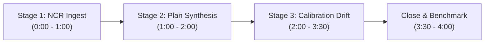

# Metrologic: 4-Minute Demo Script

> **MongoDB Student Hackathon 2026**  
> **Pitch Duration:** 4 minutes (1 Presenter, 1 Driver)  
> **One-Line Pitch:** *Generic retraction demotes everything downstream of an out-of-tolerance gauge. Metrologic recomputes the verdicts using ISO/IEC 17025 guardbanding, so it demotes only what actually lost its evidence.*

---

## Roles & Setup
- **Presenter:** Speaks the narrative, presents problem context, explains architecture, and fields judge questions.
- **Driver:** Operates the live UI at `http://localhost:3000`, clicks the control bar buttons, and points to the graph and inspector.
- **Display URL:** `http://localhost:3000`
- **Fallback URL:** Mode toggle chip: `FIXTURES · offline` (works 100% offline without network).

---

## Timeline & Step-by-Step Script

### Stage 1: Learning with Provenance (0:00 – 1:00)
- **Goal:** Demonstrate that every agent lesson carries deterministic measurement citations and multi-instrument support.
- **Action 1:** Driver clicks **`Reset`**, then clicks **`Stage 1a · ingest NCR`**.
- **Presenter (Verbatim):**
  > "In high-precision manufacturing, AI agents that recommend machining parameters usually suffer from memory rot—they memorize advice without knowing which instruments measured the results.
  >
  > Here, our shop filed NCR-0412 for a tapered bore on a titanium housing. Notice what Metrologic did: it drafted two lessons, L1 and L2, and one failed attempt, F1. Crucially, none of these are free text—every single lesson is mathematically tied to specific measurements taken on Bore Gauge BG-07. They enter the database in **PROVISIONAL** state."
- **Action 2:** Driver clicks **`Stage 1b · corroborate L1`**.
- **Presenter (Verbatim):**
  > "Now, another job measures the spring pass on an independent CMM. Watch L1 turn green—it is now **ACTIVE**. Two distinct instruments now corroborate this lesson. But notice L2: it still rests solely on Bore Gauge BG-07."

---

### Stage 2: Recall in a New Session (1:00 – 2:00)
- **Goal:** Show Atlas Vector Search recall with state bias and explainability.
- **Action 3:** Driver clicks **`Stage 2 · ask for plan`**.
- **Presenter (Verbatim):**
  > "Next shift, an engineer requests a process plan for finish boring an Inconel 718 sleeve. Metrologic uses **MongoDB Atlas Vector Search** with 1024-dimensional Voyage embeddings to retrieve relevant memories.
  >
  > The ranking engine doesn't just look at semantic similarity—it incorporates state bias, scope matching, and empirical memory worth. The synthesized plan applies L1 and L2, and explicitly tells the machinist to *avoid* feed reduction alone, citing failed attempt F1."
- **Action 4:** Driver clicks node **`L2`** in the Provenance Graph (or clicks chip L2) to open the **Memory Inspector**, then clicks **`Arm TTL`**.
- **Presenter (Verbatim):**
  > "In the inspector, every term is transparent: cosine distance, state bias, and the exact supporting measurements.
  >
  > Now we click **Arm TTL** to register an exploratory trial memory T1 with an automatic 30-second TTL index in MongoDB."

---

### Stage 3: Calibration Out-of-Tolerance & Change Stream Cascade (2:00 – 3:30)
- **Goal:** Demonstrate ISO/IEC 17025 clause 7.1.5.2 handling—verdict recomputation vs generic blanket retraction.
- **Action 5:** Driver clicks **`Post calibration: BG-07 +6 µm`**.
- **Presenter (Verbatim):**
  > "Now the critical event happens. ISO/IEC 17025 Clause 7.1.5.2 mandates: when a gauge is found out of calibration, previous measurement results must be evaluated. In standard software, this notice never reaches the AI agent.
  >
  > The calibration lab reports BG-07 has an as-found error of +6 µm with 2 µm uncertainty. 
  > Watch the **Event Feed**: MongoDB **Change Streams** detect the update in real time. Metrologic recomputes every affected measurement's interval using deterministic guardbanding:
  > 
  > - Look at Bore Gauge BG-07: its measurements flip to indeterminate or fail.
  > - Look at **L1**: It stays **ACTIVE**! Why? Because Metrologic traces its multi-instrument lattice—L1 is independently supported by CMM-02!
  > - But look at **L2**: Because its only evidence was on BG-07, it demotes to **NEEDS_VERIFICATION**.
  > - In the **Review List**, past decisions D1, D2, and D-STAGE2 that relied on L2 are automatically flagged with their part serial numbers."
- **Action 6:** Driver clicks **`Re-ask plan`**.
- **Presenter (Verbatim):**
  > "When we re-query the agent, look at the plan diff: Metrologic doesn't throw away the lesson or stall the factory. It automatically alters the plan from *Apply* to: **'Verify on CMM-02 before adopting'**."
- **Action 7:** Point to the Event Feed showing `ttl_deleted` for trial T1 (or click **`Replay TTL event`** if already expired).
- **Presenter (Verbatim):**
  > "Simultaneously, our temporary trial T1 expired via MongoDB's background TTL monitor, cleanly retiring experimental memory."

---

### Close & Benchmark Results (3:30 – 4:00)
- **Goal:** Quantitative impact and conclusion.
- **Presenter (Verbatim):**
  > "Existing systems like PACMI or Recant use topological invalidation—they delete or demote everything downstream of the gauge.
  >
  > We ran a 20-scenario calibration-drift benchmark:
  > - **Topology-only demoted 60 lessons** unnecessarily—causing severe production downtime.
  > - **Metrologic avoided all 60 false demotions**, while suffering **zero quality escapes**.
  >
  > By grounding agent memory in metrological reality with MongoDB Atlas Vector Search, Change Streams, and pre-image auditing, Metrologic brings surgical trustworthiness to production AI."

---

## Anticipated Judge Questions & Crisp Answers

#### Q1: "How is this different from existing knowledge graph retraction methods like PACMI or Recant?"
> **Answer:** "PACMI and Recant treat graph edges as boolean dependencies: if a parent gauge is bad, every child node is invalidated. In metrology, a gauge can be out of tolerance by 6 µm, but a part with a ±50 µm tolerance is still unequivocally valid. Metrologic recomputes the interval verdict using ISO/IEC 17025 guardbanding ($x' = x - e \pm U$). Only measurements whose verdicts flip propagate up the lattice."

#### Q2: "Why not simply delete invalidated lessons instead of demoting them?"
> **Answer:** "Aerospace and medical device standards (AS9100 / ISO 13485) require complete traceability. Invalidation history must be audited. Furthermore, demoting to `NEEDS_VERIFICATION` allows the system to recommend the lesson with a mandatory verification step on an alternate instrument, rather than losing valuable manufacturing tacit knowledge."

#### Q3: "What specific MongoDB Atlas features did you use?"
> **Answer:** 
> 1. **Atlas Vector Search:** 1024-dimensional embeddings with pre-filter predicates (`workspace`, `state`).
> 2. **Change Streams with Pre/Post Images:** Emits realtime cascade events with before-and-after audit logs.
> 3. **TTL Indexes (`expireAfterSeconds: 0`):** Automatically reaps provisional trial memories after 30 days or quick experiments in 30 seconds.
> 4. **$graphLookup Aggregations:** Traverses multi-depth dependency trees for transitive invalidation.
