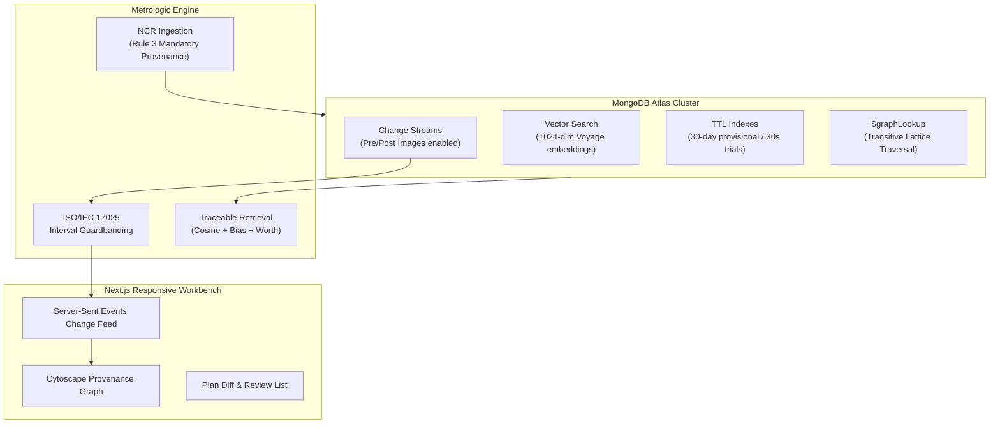

# Metrologic: Hackathon Pitch Deck (5 Slides)

---

## Slide 1: The ISO/IEC 17025 Clause 7.1.5.2 Gap

### The Problem in Precision Manufacturing
* **Machining agents memorize lessons without provenance:** Current LLM agents extract rules of thumb from shop non-conformance reports (NCRs), but treat them as detached text.
* **The Metrological Reality:** Every inspection measurement relies on physical instruments (gauges, micrometers, CMMs) subject to mechanical wear and calibration drift.
* **The Regulatory Mandate (Clause 7.1.5.2):**
  > *"When measuring equipment is found to be unfit for its intended purpose, its previous measurement results shall be examined."*
* **The Gap Today:** When a calibration lab reports a gauge out of tolerance, the notice is filed in quality archives. It **never propagates** back to the agent's knowledge base. The AI continues recommending faulty parameters or, worse, uncalibrated fixes.

---

## Slide 2: The Core Idea — Verdict Recomputation

```
TRADITIONAL TOPOLOGY-BASED RETRACTION (PACMI / Recant):
[ Gauge Drifts ] ───(BLANKET INVALIDATION)───> [ ALL 60 LESSONS TRASHED ]
                                                      └── Production Stops!

METROLOGIC RECOMPUTATION LATTICE:
[ Gauge Drifts (+6µm) ]
         │
         ├── Measurement M1 (Margin 50µm)  ──> Still PASS (Retained)
         ├── Measurement M2 (Margin 2µm)   ──> Flip to INDETERMINATE
         │
         ├── Lesson L1 (Corroborated by CMM) ──> STAYS ACTIVE!
         └── Lesson L2 (Supported by BG-07 only) ──> Demoted to NEEDS_VERIFICATION
                                                      └── Plan: "Verify on CMM-02"
```

* **One-Line Pitch:**  
  *Generic retraction demotes everything downstream of an out-of-tolerance gauge. Metrologic recomputes the verdicts using mathematical guardbanding, demoting only what actually lost its evidence.*
* **Selective Demotion:** Instead of deleting knowledge, lessons demote to `NEEDS_VERIFICATION` and prompt verification on an independent instrument.

---

## Slide 3: Architecture & MongoDB Atlas Core



* **Atlas Vector Search:** Sub-10ms semantic retrieval pre-filtered by workspace and validity state.
* **Change Streams with Pre-Images:** Real-time event propagation with before/after audit records.
* **BSON TTL Indexes:** Automatic background retirement for unverified provisional trials.
* **$graphLookup:** Recursive graph traversal over multi-instrument support sets.

---

## Slide 4: Live Demo Walkthrough (4-Stage Flow)

| Stage | Action | Metrologic Response | MongoDB Feature |
|---|---|---|---|
| **1a. NCR Ingest** | Ingest NCR-0412 for tapered titanium bore | Extracts L1, L2, F1 with mandatory measurement IDs | Document schema validation |
| **1b. Corroborate** | Job NCR-0419 measured on CMM-02 | L1 independent support confirmed $\rightarrow$ **ACTIVE** | Multi-instrument lattice |
| **2. Plan Recall** | User queries Inconel 718 bore plan | Recommends L1 & L2; avoids F1 with explainable trace | Atlas Vector Search + State bias |
| **3. Calibration Drift** | BG-07 reported +6 µm out of tolerance | Measurements recomputed: L1 stays **ACTIVE**, L2 demotes | Change Stream cascade |
| **3b. Adaptive Plan** | Re-ask identical process query | Plan automatically inserts: **"Verify on CMM-02 first"** | Plan rewording engine |

---

## Slide 5: Comparison & Empirical Benchmark

### Metrologic vs Existing Invalidation Approaches

| Capability | Generic RAG | PACMI / Recant | Metrologic |
|---|---|---|---|
| **Provenance Tracking** | ❌ None | ⚠️ Graph edges only | ✅ Exact Measurement IDs & Gauges |
| **Drift Handling** | ❌ Blind | ⚠️ Blanket edge retraction | ✅ Recomputes ISO/IEC 17025 guardbands |
| **Multi-Instrument Lattice** | ❌ No | ❌ No | ✅ Survives if independent gauge holds |
| **Impact on Operations** | High Risk (Escapes) | High Cost (Over-demotion) | **Zero False Demotions / Zero Escapes** |

### Benchmark Results (20 Drift Scenarios, Error: 0.01mm, U: 0.003mm)
* **Topology-Only Invalidation:**
  - **60 False Demotions:** Shut down valid production lines because of blanket invalidation.
* **Metrologic Recomputation:**
  - **60 False Demotions Avoided (100% saved)**
  - **0 Undetected Quality Escapes**
  - **0 Unnecessary Verification Delays**
